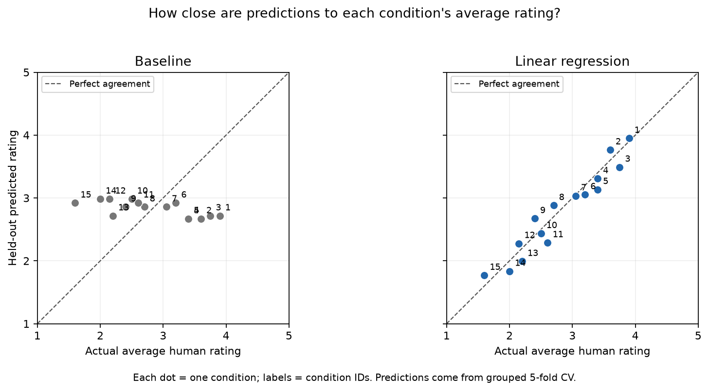

# WebRTC QoE Intelligence — V1

Can delay, jitter, and packet loss predict subjective call quality for network conditions excluded from training?

This project compares a constant training-mean baseline with ordinary linear regression on **300 individual ACR ratings across 15 network conditions**. Grouped five-fold cross-validation keeps all ratings for a condition together.

## Results

| Model | Cross-validated MAE, rating points |
|---|---:|
| Training-mean baseline | 0.877 |
| Linear regression | 0.671 |

Linear regression reduced MAE by 0.206 rating points (about 23.5%) and improved on the baseline in all five folds. Each fold held out three conditions and trained on twelve. MAE is evaluated against individual ratings; lower is better. These are held-out predictions, not scores from fitting and evaluating on the same data.



Each point represents one held-out condition. The diagonal marks agreement with its human **average**; this plot is distinct from the individual-rating MAE above.

## Data and attribution

Source: [WebRTC-QoE: A Dataset of Quality of Experience in Audio-Video Communications](https://zenodo.org/records/15836614). Only `data/raw/Subjective_results_dataset.csv` is used. It contains 15 conditions, three network inputs, and 20 user-rating columns, reshaped to one rating per row. Scores run from 1 (Bad) to 5 (Excellent). Raw ratings are preserved.

Publication: Bingol, G., Porcu, S., Floris, A., and Atzori, L. (2024). *WebRTC-QoE: A dataset of QoE assessment of subjective scores, network impairments, and facial & speech features*. Computer Networks, 244, 110356. [DOI](https://doi.org/10.1016/j.comnet.2024.110356).

The CSV was supplied locally; its SHA-256 fingerprint is stored with the model metadata. Dataset ownership remains with its creators. No dataset redistribution license is asserted by this project; consult the source record and applicable terms before redistribution.

## Method

- Inputs: delay in milliseconds, jitter in milliseconds, packet loss in percentage points (15 means 15%).
- Target: individual numeric ACR rating; the prediction estimates expected quality, not a personalized user response.
- Initial condition-aware holdout illustrates the baseline and regression.
- Main evaluation: shuffled GroupKFold with five folds and seed 42, grouping the actual network-setting combinations. Each fold fits fresh models using only its training ratings.
- Coefficients in the walkthrough describe the initial 12-condition model. Each CV fold has its own fitted model.
- Final artifact: the fixed linear-regression specification refitted on all 300 ratings after evaluation. This fit is for reuse and does not generate a new test score.

## Reproduce

Tested locally on an Apple Silicon Mac with Python 3.14.7. From the project root, recreate the exact platform-specific environment:

```bash
conda create --prefix ./.conda --file conda-osx-arm64.lock.txt
conda activate ./.conda
```

The lock file is for macOS ARM64. For other platforms, `conda env create -f environment.yml` provides the top-level package specification; platform availability has not been tested.

Open `notebooks/01_data_inspection.ipynb` in VS Code, select this environment as its notebook kernel, and run cells from top to bottom. The notebook locates data relative to the project root or notebooks folder, regenerates the plot, and writes the final model and metadata. Internet access is needed if Conda packages are not cached.

## Use the saved model

Run from the project root using the recorded environment:

```python
import joblib
import pandas as pd

bundle = joblib.load("models/qoe_linear_v1.joblib")
settings = pd.DataFrame([[500, 0, 15]], columns=bundle["features"])
print(bundle["model"].predict(settings)[0])
```

Load only trusted joblib artifacts. The accompanying JSON records units, coefficients, package versions, source fingerprint, and evaluation provenance.

## Limitations

There are only 15 distinct network conditions. The same participants occur across folds, so this does not test unseen users. The earlier holdout is included in CV; there is no additional untouched final test set. Fold variation is descriptive, not a confidence interval. Numeric treatment of ordinal scores and additive constant slopes are modeling assumptions. Coefficients are not causal effects or directly comparable feature-importance scores. Performance outside the observed settings is unvalidated, and linear predictions are not constrained to 1–5. V1 uses no WebRTC telemetry, speech features, or facial features.

## Project files

- `notebooks/01_data_inspection.ipynb`: analysis and interpretation.
- `data/raw/Subjective_results_dataset.csv`: original supplied data.
- `models/`: final model and metadata.
- `reports/`: evaluation plot and exported result tables.
- `environment.yml`: top-level dependencies.
- `conda-osx-arm64.lock.txt`: exact package URLs for the tested platform.
